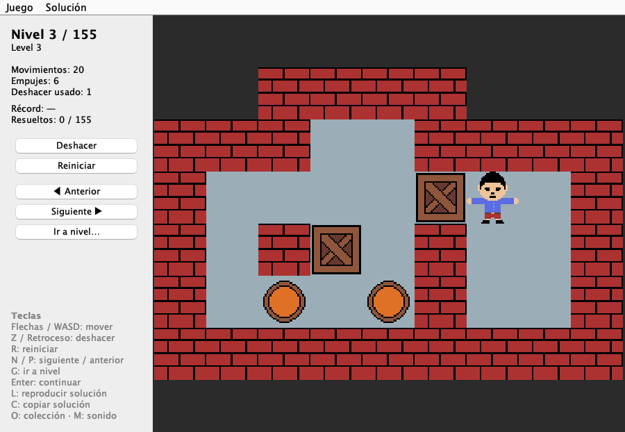
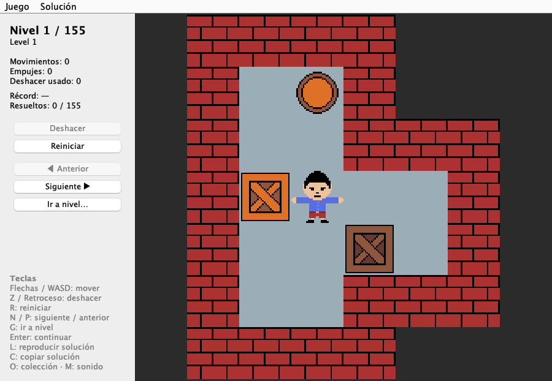
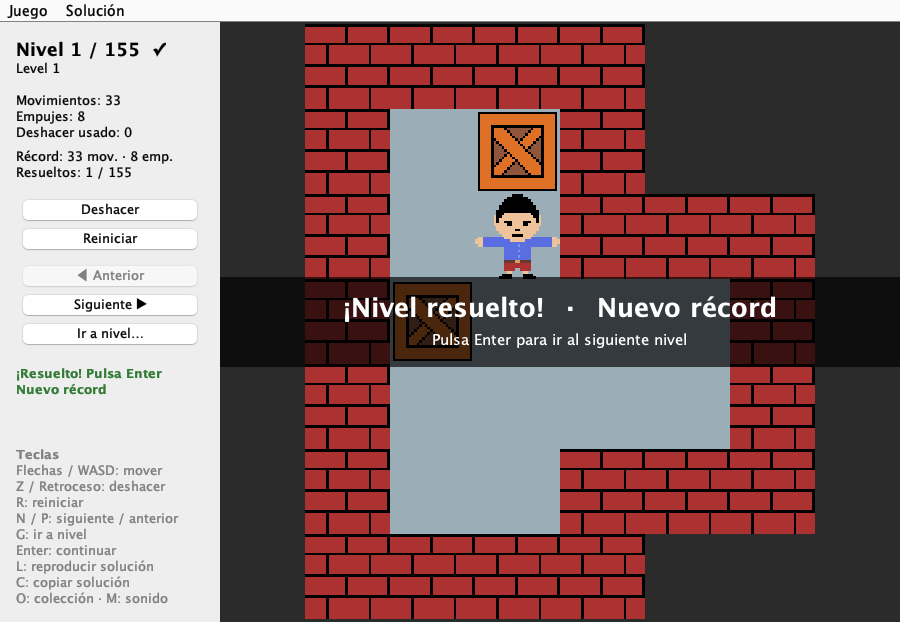
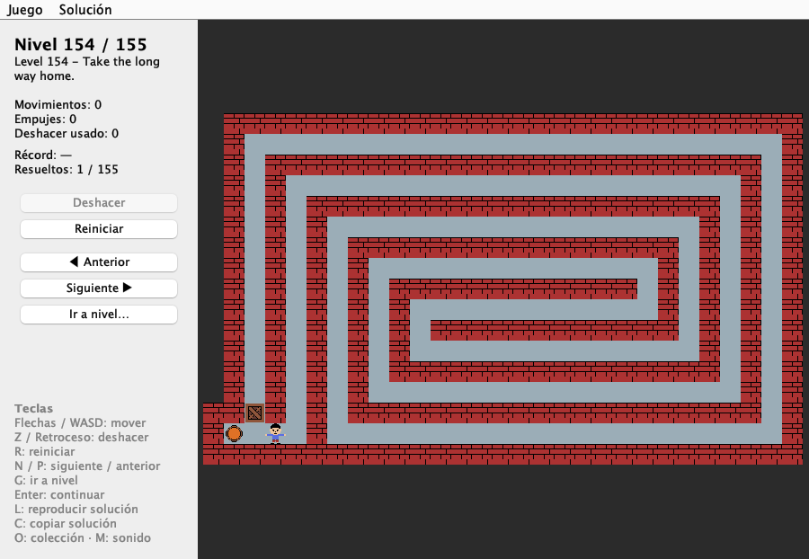
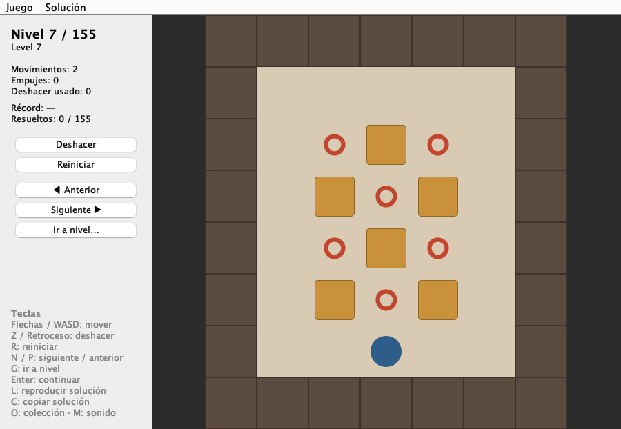

# Java Sokoban


Juego de puzles de empujar cajas en **Java 21+ con Swing**, con 155 niveles.
Está construido siguiendo **Clean Architecture (puertos y adaptadores)**, los
principios **SOLID** y buenas prácticas de Java, y tiene tests automáticos.
Solo usa el JDK: no hay dependencias en tiempo de ejecución.



## Capturas

| Inicio | Nivel resuelto con nuevo récord |
|---|---|
|  |  |
| **Niveles grandes (se escalan a la ventana)** | **Render alternativo sin sprites** |
|  |  |

## Funcionalidades

- Los 155 niveles de **Microban**, de David W. Skinner (ver [Créditos](#créditos)), en formato estándar **XSB**.
- Movimiento y empuje de cajas, con detección de victoria.
- **Deshacer ilimitado** y reinicio del nivel.
- Contadores de movimientos, empujes y veces que se ha deshecho.
- Navegación entre niveles: anterior, siguiente o saltar a uno concreto.
- **Progreso guardado:** récord de cada nivel (menos movimientos y, a
  igualdad, menos empujes), niveles resueltos y último nivel jugado de cada
  colección. Al abrir el juego se continúa donde se dejó.
- **Animaciones y sonido:** el jugador y las cajas se deslizan entre casillas,
  y hay efectos para andar, empujar, colocar una caja, deshacer y resolver. Los
  sonidos se sintetizan al arrancar, sin ficheros de audio. Se pueden silenciar.
- **Colecciones externas:** se puede abrir cualquier fichero de niveles en
  formato XSB (`.txt`, `.sok`, `.xsb`) desde el menú.
- **Soluciones en LURD:** se puede copiar la solución de la partida al
  portapapeles y reproducir una solución paso a paso (la del récord o una
  pegada). Al terminar, se puede deshacer paso a paso.
- El tablero se escala al tamaño de la ventana manteniendo los sprites nítidos.
- Si faltan los sprites, el juego usa un render alternativo de figuras geométricas.

## Cómo ejecutarlo

Solo necesitas un JDK 21 o superior.

```bash
./build.sh run        # compila y lanza el juego (continúa en el último nivel jugado)
./build.sh run 44     # empieza en el nivel 44
./build.sh test       # ejecuta los 73 tests (JUnit 5)
./build.sh jar        # genera dist/Sokoban.jar  →  java -jar dist/Sokoban.jar
```

También se puede abrir con **NetBeans** (clase principal `sokoban.App`).

El progreso se guarda en `~/.sokoban/progress.properties`.

### Controles

| Tecla | Acción |
|---|---|
| Flechas / WASD | Mover |
| Z / Retroceso | Deshacer |
| R | Reiniciar nivel |
| N / AvPág · P / RePág | Siguiente / anterior nivel |
| G | Ir a un nivel |
| Enter | Continuar tras resolver un nivel |
| O | Abrir una colección de niveles |
| L | Reproducir una solución (LURD) |
| C | Copiar la solución actual (LURD) |
| Esc | Detener la reproducción |
| M | Activar o silenciar el sonido |

### Soluciones en formato LURD

LURD es la notación estándar de Sokoban: `l` `u` `r` `d` (izquierda, arriba,
derecha, abajo) para andar y en mayúscula `L` `U` `R` `D` para empujar. El
juego acepta espacios, saltos de línea y repeticiones (`3r` = `rrr`). Antes de
reproducir una solución se comprueba entera sobre el nivel; si no encaja, se
indica en qué paso falla y la partida no cambia. Una partida reproducida no
cuenta como récord: el récord tiene que ser del jugador.

---

## Arquitectura

```
                 ┌──────────────────────────────────────────────┐
                 │  infrastructure  (adaptadores, detalles)     │
                 │   ui/swing   SwingGameWindow, BoardPanel…    │
                 │   level      Classpath/FileLevelRepository   │
                 │   progress   PropertiesProgressRepository    │
                 │   audio      SynthesizedSoundPlayer          │
                 │   ┌──────────────────────────────────────┐   │
                 │   │  application  (casos de uso)         │   │
                 │   │   GameService, GameSnapshot, Lurd    │   │
                 │   │   port/in   GameCommands             │   │
                 │   │   port/out  LevelRepository,         │   │
                 │   │             ProgressRepository,      │   │
                 │   │             GameListener             │   │
                 │   │   ┌──────────────────────────────┐   │   │
                 │   │   │  domain  (reglas del juego)  │   │   │
                 │   │   │   Puzzle, Level, Board,      │   │   │
                 │   │   │   GameState, Step…           │   │   │
                 │   │   └──────────────────────────────┘   │   │
                 │   └──────────────────────────────────────┘   │
                 └──────────────────────────────────────────────┘
          App (raíz de composición): crea las piezas concretas y las conecta
```

**Regla de dependencias:** las flechas solo apuntan hacia dentro.

| Capa | Puede importar | Comprobado |
|---|---|---|
| `domain` | solo `java.util` | sin AWT, Swing ni E/S |
| `application` | `domain` | sin Swing ni ficheros |
| `infrastructure` | `application`, `domain`, Swing, E/S | — |

Se puede comprobar en cualquier momento:

```bash
grep -rh '^import' src/sokoban/domain | sort -u
grep -rhE '^import (javax|java\.awt|java\.io|java\.nio\.file)' src/sokoban/application   # debe salir vacío
```

### Flujo de una pulsación de tecla

```
Tecla → GameActions (Action de Swing) → GameCommands.move()      [puerto de entrada]
      → GameService → Puzzle.move()                              [reglas del dominio]
      → ProgressRepository.saveBestScore()  (si resuelve)        [puerto de salida]
      → GameListener.onGameChanged(GameSnapshot)                 [puerto de salida]
      → SwingGameWindow → InfoPanel / BoardPanel → TileRenderer  [pintado y animación]
                        → SoundCue → SoundPlayer                 [sonido]
```

### Estructura de ficheros

```
src/
  sokoban/App.java                          raíz de composición
  sokoban/domain/                           Puzzle, Level, Board, GameState, Position,
                                            Direction, Step, Terrain, MoveResult
  sokoban/application/                      GameService, GameSnapshot, GameEvent, Motion,
                                            TileGrid, Tile, Score, Lurd, LevelFingerprint
  sokoban/application/port/in/              GameCommands
  sokoban/application/port/out/             LevelRepository, ProgressRepository,
                                            GameListener, LevelLoadException
  sokoban/infrastructure/level/             ClasspathLevelRepository, FileLevelRepository,
                                            LevelCollectionParser, XsbBoardParser
  sokoban/infrastructure/progress/          PropertiesProgressRepository
  sokoban/infrastructure/audio/             SoundPlayer, SynthesizedSoundPlayer, Sound
  sokoban/infrastructure/ui/swing/          SwingGameWindow, BoardPanel, InfoPanel,
                                            GameActions, SoundCue, TileRenderer,
                                            SpriteTileRenderer, ShapeTileRenderer
  resources/levels/levels.txt               155 niveles en formato XSB
  resources/sprites/*.png                   gráficos
test/                                       tests JUnit 5 (dominio, aplicación, infraestructura)
lib/                                        JUnit console launcher (solo para tests)
```

---

## Decisiones de diseño

### 1. Clean Architecture con puertos y adaptadores
Tres capas con las dependencias apuntando hacia el dominio. La aplicación
define **puertos** (interfaces) y la infraestructura los implementa. Cada
funcionalidad nueva ha entrado como un adaptador más sin tocar las reglas del
juego: el progreso es un puerto de salida (`ProgressRepository`) con su
adaptador de ficheros, y las colecciones externas son otro adaptador de
`LevelRepository`.
- **Coste:** más ficheros. Cada clase es corta y tiene un único motivo para
  cambiar.

### 2. Terreno (fijo) separado de objetos (móviles)
`Board` guarda el terreno inmutable (`WALL`, `FLOOR`, `GOAL`, `OUTSIDE`).
`GameState` guarda la posición del jugador y un `Set` de cajas. Las reglas
quedan en unas pocas líneas legibles (`Puzzle.move`).

### 3. Estado inmutable + Memento para deshacer
`GameState` es un `record` inmutable. Cada movimiento apila el estado anterior
junto con el `Step` dado (dirección y si empujó). Deshacer es desapilar. Los
movimientos se calculan como el tamaño del historial, así que siempre cuadran,
y el mismo historial es la solución en LURD.

### 4. Modelo de dominio rico
Las reglas están en `Puzzle` (raíz del agregado) y no en un "servicio" o
controlador. `Level` valida sus invariantes al construirse (un jugador, cajas
en casillas transitables, no más cajas que objetivos): mejor fallar al cargar
que a mitad de partida.

### 5. Observer + DTO inmutable hacia la vista
- `GameService` publica una `GameSnapshot` (record inmutable) a los
  `GameListener`. La vista nunca recibe el `Puzzle` mutable.
- La foto incluye qué ha pasado (`GameEvent`) y el desplazamiento del jugador
  (`Motion`). Con eso la vista decide la animación y el sonido sin conocer las
  reglas.
- `Tile` es un *view model*: combina terreno y objeto en una etiqueta lista
  para pintar. Así la UI no depende de las clases del dominio.

### 6. Strategy para el pintado (abierto/cerrado, Liskov)
`BoardPanel` solo calcula la geometría y delega cada casilla en un
`TileRenderer`, que pinta en dos capas (suelo y objeto). Las capas permiten
dibujar el jugador y la caja desplazados durante la animación. Hay dos
implementaciones intercambiables:
- `SpriteTileRenderer`: PNG pintados por capas.
- `ShapeTileRenderer`: figuras vectoriales. Se usa automáticamente si faltan
  los sprites, así el juego sigue siendo jugable.

### 7. Animación solo visual
El estado de la partida cambia al instante; `BoardPanel` solo dibuja el
jugador deslizándose desde su casilla anterior durante 110 ms con un `Timer`
de Swing. Si se pulsa otra tecla a mitad, se procesa enseguida y la animación
salta a la nueva foto, así el juego nunca se nota lento.

### 8. Sonido sintetizado y opcional
`SynthesizedSoundPlayer` genera cada efecto como ondas senoidales con
`javax.sound.sampled` y lo guarda en un `Clip`. No hay ficheros de audio ni
licencias que gestionar. Si el sistema no tiene audio se usa
`SoundPlayer.SILENT` y el juego funciona igual. `SoundCue` decide qué sonido
toca para cada foto y se prueba sin audio.

### 9. Récords identificados por el contenido del nivel
Los récords se guardan con una huella SHA-256 del tablero (`LevelFingerprint`)
y no con el número del nivel. Un mismo nivel conserva su récord aunque
aparezca en otra colección o en otra posición. El progreso se guarda en un
`.properties` escribiendo primero un temporal y moviéndolo encima, para no
dejar el fichero a medias. Si no se puede guardar, se registra un aviso y la
partida continúa.

### 10. Reproducción: la aplicación sabe qué, la vista sabe cuándo
`GameService.startReplay` valida la solución entera en una partida aparte y,
si encaja, reinicia el nivel y guarda los pasos pendientes. La ventana marca
el ritmo con un `Timer` que llama a `replayStep()`. Cualquier orden del
jugador detiene la reproducción.

### 11. Key Bindings, `Action` compartidas y menú
`GameActions` define cada acción una sola vez. El botón, la tecla y la opción
del menú comparten el mismo `Action`, y su estado activo/inactivo se
sincroniza solo. Los atajos se registran con `WHEN_IN_FOCUSED_WINDOW`, así
funcionan tenga quien tenga el foco.

### 12. Recursos en el classpath
`getResourceAsStream("/resources/…")` funciona desde el IDE, la terminal y el
jar.

### 13. Parser tolerante y separado de la E/S
- Los repositorios solo leen. `LevelCollectionParser` trocea el texto.
  `XsbBoardParser` interpreta un tablero.
- Un nivel defectuoso se descarta con un aviso y no impide cargar los demás.
- Acepta comentarios con `;` como títulos y ficheros en UTF-8 o ISO-8859-1,
  habituales en colecciones de otros autores.
- Un *flood fill* desde el jugador distingue el suelo interior del exterior,
  para no pintar baldosas fuera de los muros.

### 14. Raíz de composición sin framework
`App.main` es el único sitio que hace `new` de clases concretas de distintas
capas. Para este tamaño, la inyección por constructor manual es más simple que
Spring o Guice (KISS / YAGNI).

### 15. Concurrencia
Swing no es thread-safe. La UI se crea con `SwingUtilities.invokeLater`, y
`SwingGameWindow.onGameChanged` reenvía al EDT si se le llama desde otro hilo.
El dominio no se sincroniza porque solo lo usa el EDT (documentado en `Puzzle`).

### 16. Excepciones por capa
- `InvalidLevelException` (dominio): datos de nivel incorrectos.
- `LevelLoadException` (puerto de aplicación): los repositorios traducen las
  `IOException` a esta excepción, así la aplicación no conoce detalles de E/S.
- `InvalidSolutionException` (aplicación): una solución LURD que no se puede
  leer o no encaja con el nivel. Su mensaje se muestra tal cual al jugador.
- Se registra con `System.Logger` (sin dependencias externas).

### 17. Tests
73 tests JUnit 5 con estructura *Arrange-Act-Assert*, `@Nested`,
`@ParameterizedTest` y `@TempDir`:
- **Dominio:** reglas de movimiento, empuje, victoria, deshacer y reiniciar,
  historial de pasos e invariantes de `Level`.
- **Aplicación:** `GameService` con dobles en memoria (récords, último nivel,
  cambio de colección, reproducción y validación de soluciones), la notación
  LURD y la huella de los niveles. No hace falta ninguna librería de mocks.
- **Infraestructura:** los parsers, la lectura de ficheros externos, la
  persistencia del progreso, la elección de sonidos y un test de integración
  que carga los 155 niveles reales.

Se usan las aserciones de JUnit en lugar de AssertJ para no añadir más
dependencias. Solo hay un jar, y únicamente para los tests.

## Skills de Claude Code incluidas

En `.claude/skills/` hay skills de Java descargadas de
[decebals/claude-code-java](https://github.com/decebals/claude-code-java)
(licencia MIT, ver `LICENSE-claude-code-java`): `solid-principles`,
`clean-code`, `architecture-review`, `design-patterns`, `test-quality` y
`java-code-review`. Se han usado como guía durante el desarrollo y
Claude Code las carga automáticamente al trabajar en este proyecto.

---

## Créditos

- **Niveles:** colección *Microban* (155 puzles, 2000) de **David W. Skinner**.
  Se redistribuye reconociendo su autoría, con su permiso. Detalles en
  [`src/resources/levels/CREDITS.md`](src/resources/levels/CREDITS.md).
- **Skills de Claude Code:** [decebals/claude-code-java](https://github.com/decebals/claude-code-java) (MIT).
- **Código y sprites:** Juan Gestal (licencia MIT).

*Sokoban* es una marca registrada de Thinking Rabbit. Este es un proyecto
educativo independiente y no está afiliado ni respaldado por los titulares de
la marca.

## Licencia

El código se publica bajo la [licencia MIT](LICENSE). Los niveles de Microban
**no** están cubiertos por ella: pertenecen a su autor (ver Créditos y [`NOTICE`](NOTICE)).
